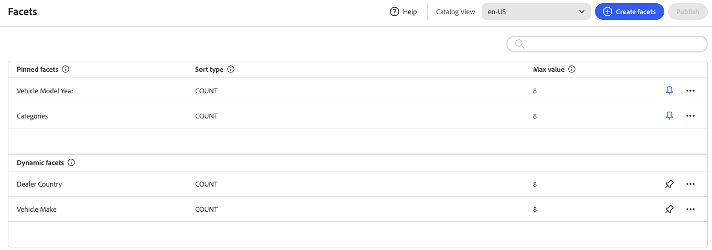

<!--
SOURCE OF TRUTH: Edit this file in the commerce.en repo:
https://github.com/Adobe-Enterprise-Docs/commerce.it-IT/blob/main/help/_includes/ccdm-shared/merchandising/facets/workspace.md

This content is shared by the Adobe Commerce Optimizer Guide (commerce.en) and the
Merchandising Services with CCDM Guide (commerce-admin.en). Changes made in commerce.en
are synced automatically to commerce-admin.en, so do not edit the copy in that repo.
This includes related images in help/assets/ccdm-shared/.
-->

# Facet Workspace

Nell&#39;area di lavoro *Facets* sono elencati tutti i facet attualmente disponibili e sono disponibili gli strumenti necessari per impostare e gestire i facet. I facet bloccati vengono visualizzati per primi nell&#39;elenco dei facet esistenti, seguiti dai facet dinamici. È possibile eseguire ricerche nell&#39;elenco dei facet.

## Descrizioni dei campi

| Campo | Descrizione |
|--- |--- |
| Crea facet | Apre l&#39;[editor facet](add.md). |
| Etichetta | L&#39;[etichetta facet](type.md#facet-labels) visibile nella vetrina può essere modificata per coerenza con il tuo marchio. |
| Tipo di ordinamento | Metodo utilizzato per [ordinare](type.md#sort-type) facet. Tutti gli storefront ordinano i facet in ordine alfabetico e per `Count`. Opzioni: Alfabetico - Ordina alfabeticamente i facet. Conteggio - Ordina i facet in base al numero di corrispondenze trovate. |
| Valore massimo | Il numero massimo di valori che possono essere visualizzati nella vetrina per ogni facet. I facet che rappresentano un intervallo di valori vengono distribuiti in modo uniforme. Voci valide: 0 - 100; valore predefinito: 8. |

## Controlli

| Controllo | Descrizione |
|--- |--- |
|  | Aggiunge o rimuove un facet all&#39;inizio dell&#39;elenco *Filtri*. |
|  | Visualizza un menu di ulteriori azioni che possono essere applicate al facet selezionato. Opzioni: Modifica, Elimina |
