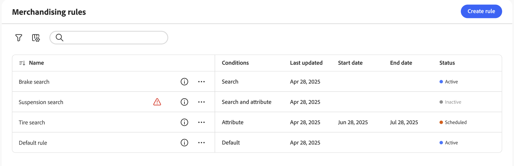

<!--
SOURCE OF TRUTH: Edit this file in the commerce.en repo:
https://github.com/Adobe-Enterprise-Docs/commerce.en/blob/main/help/_includes/ccdm-shared/merchandising/rules/workspace.md

This content is shared by the Adobe Commerce Optimizer Guide (commerce.en) and the
Merchandising Services with CCDM Guide (commerce-admin.en). Changes made in commerce.en
are synced automatically to commerce-admin.en, so do not edit the copy in that repo.
This includes related images in help/assets/ccdm-shared/.
-->

# Workspace delle regole di merchandising

Nell&#39;area di lavoro *Regole di merchandising* sono elencati la selezione corrente delle regole e il relativo stato e sono disponibili gli strumenti necessari per creare e gestire le regole. È possibile definire l&#39;ambito delle regole per tutte le [visualizzazioni catalogo](https://experienceleague.adobe.com/en/docs/commerce/optimizer/setup/catalog-view) (globale) o per una singola visualizzazione catalogo. Consulta [Selezionare la vista catalogo](#select-catalog-view) per informazioni su come filtrare per vista catalogo e creare regole per vista catalogo. Dall’area di lavoro puoi:

- Cerca regole
- Visualizza dettagli regola
- Attiva/disattiva regole
- Elimina regole
- Accedere all’editor di regole

L&#39;area di lavoro include anche **[regole di soppressione della ricerca](https://experienceleague.adobe.com/en/docs/commerce/optimizer/merchandising/rules/overview#search-suppression-rules)**. Utilizzare gli stessi controlli di gestione delle regole per modificare, pianificare, abilitare o disabilitare queste regole. Per configurare le condizioni di query e le modifiche di pubblicazione, vedere [Creare e gestire le regole di soppressione della ricerca](https://experienceleague.adobe.com/en/docs/commerce/optimizer/merchandising/rules/add#search-suppression-rules). Non viene visualizzata un’anteprima per le regole di soppressione della ricerca.

## Mostra/nascondi colonne

1. Nell&#39;angolo superiore destro fare clic su **Mostra/nascondi**  colonne.

1. Nel menu, effettuate una delle seguenti operazioni:

   - Per visualizzare una colonna nascosta, fare clic sul nome di una colonna senza segno di spunta.
   - Per nascondere una colonna visibile, fare clic su un nome di colonna con un segno di spunta.

## Filtra regole per stato

1. Se il tuo archivio ha molte regole, puoi filtrarle per stato per ridurre l’elenco. Per impostazione predefinita, nell&#39;elenco Regole vengono visualizzate tutte le regole.

1. Per elencare solo le regole con un&#39;impostazione di stato specifica, impostare **Stato** su una delle seguenti opzioni:

   - Tutti
   - Attivo
   - Inattivo
   - Pianificato
   - Bozza

   Puoi anche filtrare per **Condizioni**, **Data inizio**, **Data fine** e **Ultimo aggiornamento**.

## Visualizza dettagli

Il pannello dei dettagli mostra il nome della regola, lo stato, le condizioni e gli eventi, la data di inizio e di fine, la descrizione e la data dell’ultima modifica. Le regole possono essere abilitate, modificate ed eliminate dal pannello dei dettagli.

1. Nell&#39;area di lavoro *Regole di merchandising*, individua la regola nella griglia che desideri visualizzare e fai clic sull&#39;icona ().

   Puoi effettuare una delle seguenti operazioni dal menu:

   - Modifica regola
   - Elimina regola
   - Attiva/Disattiva regola

## Attivare o disattivare una regola {#enable-disable-rule}

1. Trova la regola nell&#39;area di lavoro *Regole di merchandising*.
1. Apri **Altro** (...) e selezionare **Abilita regola** o **Disabilita regola**. È inoltre possibile utilizzare il controllo **Enabled** nel pannello dei dettagli.
1. Conferma lo stato aggiornato. Una regola abilitata con una data di inizio futura rimane programmata fino a tale data.

Per una **regola di soppressione della ricerca**, la disabilitazione della regola impedisce a tale regola di bloccare le query corrispondenti senza eliminarne le condizioni. Altre regole di soppressione attive possono ancora bloccare tali query. Per modificare le condizioni o le date della regola, selezionare **Modifica**, rivedere le modifiche e fare clic su **Salva e pubblica**.

## Descrizioni delle colonne

| Colonna | Descrizione |
|--- |--- |
| Nome | Nome della regola. |
| Ultimo aggiornamento | Data dell’ultimo aggiornamento della regola. |
| Data di inizio | Data di inizio di una regola pianificata. |
| Data di fine | Data di fine di una regola pianificata. |
| Stato | Lo stato con codice colore indica lo stato corrente della regola. Utilizzare il controllo Stato sopra la griglia per filtrare le regole per stato. Valori: Tutti gli stati - Visualizza tutte le regole indipendentemente dallo stato. Attivo (blu): visualizza solo le regole attive. Pianificato (arancione): visualizza solo le regole pianificate. Inattivo (grigio): visualizza solo le regole inattive. |

## Controlli

| Controllo | Descrizione |
|--- |--- |
| Aggiungi regola | Apre l&#39;[editor regole](add.md). |
| Vista catalogo | Filtra la tabella in base alle regole applicabili alla vista catalogo selezionata. Imposta anche l&#39;ambito quando [crei una regola](add.md). Opzioni: *Tutte le visualizzazioni* o una [visualizzazione catalogo](https://experienceleague.adobe.com/en/docs/commerce/optimizer/setup/catalog-view) specifica. Vedi [Seleziona visualizzazione catalogo](#select-catalog-view). |
| Stato | Filtra l’elenco delle regole in base allo stato. Opzioni: Tutti, Attivo, Inattivo, Pianificato |
|  | Specifica le colonne visibili nella griglia. Opzioni: Ultimo aggiornamento, Data inizio, Data fine, Stato |
| Ricerca | Cerca una regola per nome completo o per corrispondenza parziale. |
|  | Visualizza un menu di altre azioni che possono essere applicate alla regola selezionata. Opzioni: Modifica, Visualizza dettagli, Elimina |

## Dettagli regola

| Campo | Descrizione |
|--- |--- |
| Stato | Stato corrente della regola. |
| Condizioni | Query di ricerca che descrive le condizioni associate alla regola. |
| Data di inizio | Data in cui la regola entra in vigore, se pianificata. |
| Data di fine | Data di scadenza della regola, se pianificata. |
| Descrizione | Breve descrizione della regola. |
| Ultimo aggiornamento | Data e ora dell’ultimo aggiornamento della regola. |
| Abilitato | Controllo che modifica lo stato della regola. Opzioni: Abilitato / Disabilitato |

## Seleziona vista catalogo

Il selettore **[!UICONTROL Catalog view]** nella pagina Regole di merchandising esegue due operazioni:

1. **Filtra la tabella** - Mostra solo le regole (e i relativi dettagli) che si applicano alla vista catalogo selezionata.
1. **Imposta l&#39;ambito per le nuove regole**. Quando [crei una regola](add.md), la visualizzazione catalogo selezionata viene utilizzata come ambito della regola. Le opzioni sono *Tutte le visualizzazioni* o una [visualizzazione catalogo](https://experienceleague.adobe.com/en/docs/commerce/optimizer/setup/catalog-view) specifica.

   - **Tutte le visualizzazioni** - La regola si applica a tutte le visualizzazioni catalogo. Il comportamento di ricerca e classificazione è lo stesso in ogni vetrina che utilizza il catalogo.
   - **Vista catalogo** - La regola si applica solo alla vista catalogo selezionata (ad esempio, una vetrina, un&#39;area geografica, un rivenditore o un marchio). Utilizzalo quando diverse visualizzazioni del catalogo richiedono una logica di merchandising diversa.

Per informazioni dettagliate sulla creazione di una regola e sull&#39;impostazione del relativo ambito, vedere [Creare e gestire regole](add.md).

### Perché creare una regola per vista catalogo?

Crea regole per visualizzazione catalogo quando diversi store, aree geografiche o marchi necessitano di un comportamento diverso di ricerca e classificazione. Esempi:

- **Reti di rivenditori o distributori** - Ogni rivenditore ha la propria vista catalogo; si desidera che i diversi prodotti siano bloccati, potenziati o nascosti per rivenditore.
- **Più aree geografiche** - Visualizzazioni catalogo separate per UE, USA o altre aree geografiche con regole di merchandising specifiche per le aree geografiche.
- **Multibrand**: ogni marchio ha la propria vista catalogo e desideri regole specifiche per il marchio (ad esempio, diversi prodotti di classificazione predefinita o promossi per marchio).

Per impostazione predefinita, i dati comportamentali che alimentano la [classificazione intelligente](add.md#intelligent-ranking) (come quelli più visualizzati, più acquistati, con tendenze) vengono calcolati per visualizzazione catalogo. Le regole che utilizzano la classificazione intelligente riflettono pertanto il comportamento dell’acquirente della visualizzazione catalogo. Quando il tuo account dispone di un numero elevato di visualizzazioni del catalogo, il sistema può aggregare i dati comportamentali a livello globale per mantenere le prestazioni; in tal caso, la classificazione può essere influenzata maggiormente dalle visualizzazioni del catalogo a traffico elevato e la rilevanza per le visualizzazioni a traffico ridotto può essere ridotta. Vedi [Limiti e limiti](https://experienceleague.adobe.com/en/docs/commerce/optimizer/boundaries-limits) per i limiti correnti.

### Come impostare una regola per la vista catalogo

1. Nell&#39;area di lavoro *Regole di merchandising*, utilizza il menu a discesa **[!UICONTROL Catalog view]** per selezionare la vista catalogo in cui applicare la regola.
1. Fare clic su **[!UICONTROL Create rule]**.

   La regola creata ha l&#39;ambito della vista catalogo selezionata.
1. Genera la regola nell&#39;[editor regole](add.md).

   Nell’editor, definisci le condizioni, gli eventi e i dettagli che si applicano al tipo di regola. Le regole di soppressione della ricerca utilizzano le condizioni di query per bloccare i risultati solo nella vista catalogo selezionata. Non modificano la visibilità dei prodotti tramite la navigazione per categorie, pagine di merchandising, consigli o URL diretti di prodotti.

Non è possibile modificare la vista catalogo (ambito) di una regola dopo la sua creazione. Per applicare una logica simile a un’altra vista catalogo, crea una nuova regola e seleziona la vista catalogo prima di creare.
