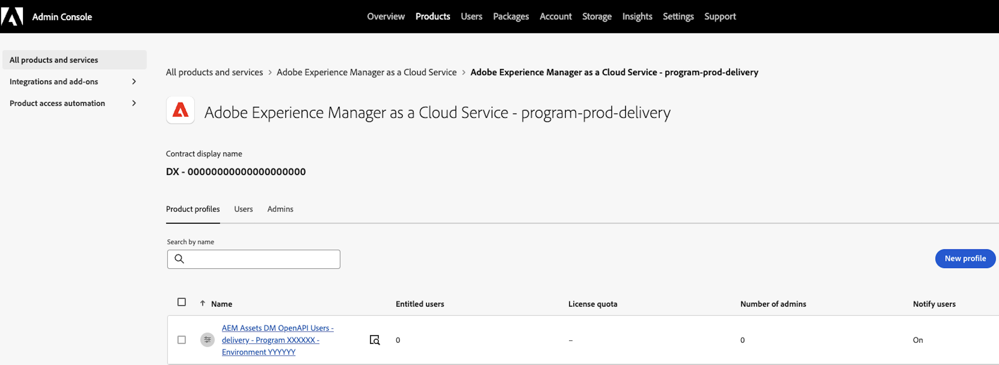

# Autorizzazioni utente e IMS

**IMS** (Adobe Identity Management System) è il livello di autenticazione.

* Per Adobe Commerce as a Cloud Service, l’amministratore abilita l’autenticazione IMS per impostazione predefinita.
* Per Adobe Commerce su cloud o on-premise, IMS è facoltativo.

  [L&#39;abilitazione di IMS per Commerce](https://experienceleague.adobe.com/it/docs/commerce-admin/start/admin/ims/adobe-ims-config){target=_blank} fornisce un&#39;interfaccia utente di configurazione avanzata con il selettore risorse e gli elenchi a discesa dell&#39;ambiente e del dominio. Se nella configurazione vengono visualizzati campi **ID programma** e **ID ambiente** separati, è possibile immettere manualmente tali identificatori senza IMS.

Quando si utilizza IMS, l&#39;integrazione AEM Assets richiede anche **profili di prodotto Adobe Admin Console** specifici. Gli utenti che configurano l&#39;integrazione in Commerce Admin hanno bisogno del profilo di prodotto **Utenti AEM Assets DM OpenAPI - delivery** oppure del profilo di prodotto **author** come fallback. Questo accesso è controllato tramite i profili di prodotto di Admin Console nell’organizzazione IMS dell’utente e consente di:

* **Selettore risorse** consente di selezionare immagini da AEM Assets durante la gestione di immagini di categorie o contenuti di Page Builder.
* **Campi di configurazione con compilazione automatica**, inclusi gli elenchi a discesa **Ambiente AEM** e **Mappatura dominio AEM**, che richiamano valori dalla sessione IMS dell&#39;utente. Consulta [Configurare l&#39;integrazione](setup-synchronization.md) per la selezione dell&#39;ambiente e l&#39;immissione manuale dell&#39;ID.

Se non disponi delle autorizzazioni corrette, il Selettore risorse non è disponibile e questi campi appaiono vuoti o richiedono l’immissione manuale.

>[!IMPORTANT]
>
> I profili di prodotto di Adobe Admin Console controllano l’accesso degli utenti alle funzioni di integrazione e non modificano le licenze richieste. L’assegnazione di un profilo di prodotto Autore non concede ai clienti l’accesso API di AEM Assets Author per Product Visuals. Consulta [Limiti di Product Visuals](../../optimizer/boundaries-limits.md#product-visuals-limits) per i requisiti di adesione.

>[!BEGINSHADEBOX]

**Interazione di IMS e delle autorizzazioni**

Adobe IMS fornisce l&#39;identità utente e il contesto dell&#39;organizzazione, mentre Adobe Admin Console definisce i **profili di prodotto** (autorizzazioni) di cui dispongono. L’integrazione di AEM Assets utilizza i dettagli IMS più il profilo assegnato per determinare se può compilare automaticamente i campi di configurazione e abilitare il selettore delle risorse.

>[!ENDSHADEBOX]

## Perché sono richiesti i profili di prodotto

L’integrazione può caricare solo domini mappati a un profilo. Pertanto, gli utenti possono disporre dei seguenti profili di prodotto:

* **Profilo prodotto di consegna AEM**. Obbligatorio per il selettore delle risorse e l’interfaccia utente di configurazione quando l’utente dispone sia di profili di authoring che di profili di consegna. L’integrazione utilizza il profilo di prodotto di consegna AEM, se disponibile.

* **Crea profilo prodotto**. Necessario per accedere all’interfaccia utente di AEM Assets. Funge anche da fallback per il selettore delle risorse e l’interfaccia utente di configurazione quando l’utente non dispone del profilo di prodotto di consegna AEM nel proprio Admin Console.

L&#39;integrazione carica ambienti e mappature di dominio dal **profilo di prodotto di consegna AEM** se disponibile, oppure torna al **profilo di prodotto Author** se il profilo di prodotto di consegna AEM non è nell&#39;Admin Console dell&#39;utente. Gli utenti devono disporre di uno di questi profili per:

* Popola gli elenchi a discesa **Ambiente AEM** e **Mappatura dominio AEM** nella configurazione amministratore di Commerce.
* Utilizza il Selettore risorse per sfogliare e selezionare le risorse da AEM Assets.

Se nessuno dei due profili è configurato, il Selettore risorse non è disponibile. Se nella configurazione vengono visualizzati campi **ID programma** e **ID ambiente** separati, è possibile immettere manualmente gli identificatori.

## Concedere le autorizzazioni per tipo di distribuzione

>[!BEGINTABS]

>[!TAB Adobe Commerce as a Cloud Service]

[!BADGE Solo SaaS]{type=Positive tooltip="Applicabile solo ai progetti Adobe Commerce as a Cloud Service e Adobe Commerce Optimizer (infrastruttura SaaS gestita da Adobe)."}

Per impostazione predefinita, il sistema abilita l’autenticazione IMS.

Aggiungi l&#39;utente al profilo di prodotto **Utenti OpenAPI di AEM Assets DM - delivery** in [Adobe Admin Console](https://adminconsole.adobe.com/) o al profilo di prodotto **author** come fallback.

>[!NOTE]
>
> Gli utenti devono essere aggiunti anche a Commerce e AEM Assets. Consulta [Aggiungere un utente ad AEM Assets o Product Visuals](https://experienceleague.adobe.com/it/docs/commerce/cloud-service/user-management#add-a-user-to-aem-assets-or-product-visuals){target=_blank} nella _Guida per l&#39;utente e Identity Management_ per l&#39;installazione completa.

{width="600" zoomable="yes"}

>[!TAB Adobe Commerce sul cloud o on-premise]

[!BADGE Solo PaaS]{type=Informative tooltip="Applicabile solo ai progetti Adobe Commerce on Cloud (infrastruttura PaaS gestita da Adobe)."}

L&#39;ID client **IMS** è necessario affinché PaaS abiliti il selettore risorse. Consulta [Configurare il progetto AEM Assets](configure-aem.md#prerequisites) per i prerequisiti, incluso come ottenere l&#39;ID client IMS quando si abilita Dynamic Media con OpenAPI.

Per utilizzare i menu a discesa Selettore risorse e **Ambiente AEM** e **Mappatura dominio AEM**:

1. [Abilita Adobe IMS per Commerce](https://experienceleague.adobe.com/it/docs/commerce-admin/start/admin/ims/adobe-ims-config){target=_blank} in modo che l&#39;amministratore di Commerce utilizzi l&#39;autenticazione IMS e possa leggere i profili di prodotto Admin Console dell&#39;utente.

1. Per richiedere un ID client IMS personalizzato per il selettore risorse, [Apri un ticket di supporto](https://experienceleague.adobe.com/it/docs/support-resources/adobe-support-tools-guide/adobe-commerce-support/adobe-commerce-help-center-user-guide#support-case).

1. Da [Adobe Admin Console](https://adminconsole.adobe.com/), aggiungi l&#39;utente al profilo di prodotto **Utenti OpenAPI di AEM Assets DM - delivery** oppure al profilo di prodotto **author** come fallback.

Per le configurazioni che visualizzano campi ID programma e ID ambiente separati, l’immissione manuale è disponibile senza IMS. Consulta [Configurare l&#39;integrazione](setup-synchronization.md).

>[!ENDTABS]

## Documentazione correlata

* [Configurare le autorizzazioni utente IMS per l&#39;integrazione di AEM Assets](setup-synchronization.md)—Connettere Commerce ad AEM Assets e configurare le regole corrispondenti.
* [Selezione manuale delle risorse](../synchronize/asset-selector-integration.md): utilizza il selettore delle risorse per le immagini delle categorie e Page Builder.
* [Aggiungi un utente ad AEM Assets o ai visualizzatori di prodotto](https://experienceleague.adobe.com/it/docs/commerce/cloud-service/user-management#add-a-user-to-aem-assets-or-product-visuals){target=_blank}. Per [!DNL Adobe Commerce as a Cloud Service], aggiungi prima gli utenti a Commerce e AEM Cloud Manager (Proprietario business, Responsabile della distribuzione). Il profilo **Utenti OpenAPI di AEM Assets DM - consegna** (o profilo **autore** come fallback) è un requisito aggiuntivo per le funzioni Selettore risorse e di compilazione automatica.
* [Assegna membri del gruppo al livello di consegna di AEM](https://experienceleague.adobe.com/it/docs/experience-manager-cloud-service/content/onboarding/journey/assign-profiles-aem#add-team-members){target=_blank}. Documentazione di AEM per l’accesso alla consegna.

