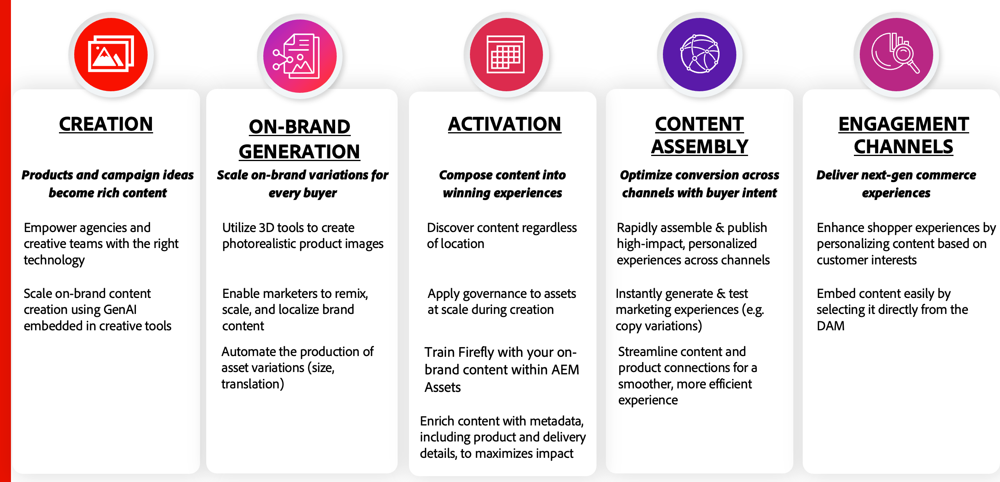

# Mantenere contenuti accurati e pertinenti

Una vera fornitura di contenuti implica una combinazione di pilastri chiave tra **Creazione e produzione**, **Flusso di lavoro e pianificazione** e **Consegna e attivazione**. Ognuno di questi pilastri è prezioso da solo e contribuisce a fornire un valore significativo alle organizzazioni:

{width="600" zoomable="yes"}

Una piattaforma di eCommerce è uno dei canali di coinvolgimento più cruciali. La disponibilità di aggiornamenti senza soluzione di continuità nel sistema di gestione delle risorse garantisce che le vetrine commerciali presentino sempre le informazioni di prodotto più aggiornate. Ciò è essenziale per raggiungere i tre obiettivi principali di qualsiasi **DAM (Digital Asset Management System)** &lt;> **integrazione Commerce**:

* Migliora **Time-to-Market (TTM)** per i nuovi lanci di prodotti.

* Eliminazione delle inefficienze operative e riduzione delle interazioni manuali.

* Assicurati la coerenza del brand fornendo sempre contenuti approvati in linea con le linee guida del brand.

Per raggiungere questi obiettivi, l&#39;integrazione AEM Assets per Commerce è abbonata a **eventi Adobe Commerce** e **AEM Assets**, garantendo la sincronizzazione dinamica tra il contenuto e l&#39;e-commerce.

## Modifiche al catalogo Adobe Commerce

L&#39;integrazione di AEM Assets ascolta gli eventi di creazione del prodotto attivati quando i prodotti vengono creati in **Admin** o utilizzando **API**. Quando viene attivato, sincronizza le risorse approvate dal DAM associate al nuovo SKU del prodotto.

Disaccoppiando la creazione dei contenuti dalla gestione dei cataloghi, le aziende ottengono diversi vantaggi:

* I team che si occupano dei contenuti possono operare in modo indipendente, assicurando la disponibilità di risorse di alta qualità pronte per il lancio dei prodotti.

* Gli aggiornamenti dei prodotti rimangono rapidi perché la creazione delle risorse non ritarda le modifiche al catalogo, consentendo una maggiore agilità nella gestione dei nuovi prodotti.

* L&#39;automazione migliora l&#39;efficienza e l&#39;accuratezza, riducendo le incongruenze tra i dati dei prodotti e i contenuti associati.

>[!NOTE]
>
> Le importazioni di prodotti CSV in PaaS e SaaS non attivano gli eventi di aggiornamento. Utilizza l’API per le importazioni e gli aggiornamenti dei cataloghi.

## Modifiche al ciclo di vita di AEM Assets

L’integrazione è in ascolto anche delle modifiche dello stato delle risorse in AEM Assets. Poiché Adobe Commerce funge da canale di coinvolgimento, nella vetrina vengono visualizzate solo le risorse approvate.

L’integrazione automatizza la gestione del ciclo di vita delle risorse per garantire che i contenuti della vetrina rimangano precisi e conformi al marchio.

* Vengono pubblicate solo le risorse approvate, mantenendo l&#39;integrità del marchio e la conformità alle normative.

* Le risorse obsolete o irrilevanti vengono rimosse automaticamente, impedendo la visualizzazione di contenuto non aggiornato.

* La sincronizzazione perfetta tra l’approvazione delle risorse e la visualizzazione dei prodotti riduce gli sforzi manuali e i ritardi.

Sfruttando l&#39;integrazione di AEM Asset Selector, le aziende possono mantenere una fornitura di contenuti semplificata, accurata ed efficiente, migliorando sia l&#39;esperienza del cliente che l&#39;efficienza operativa.
