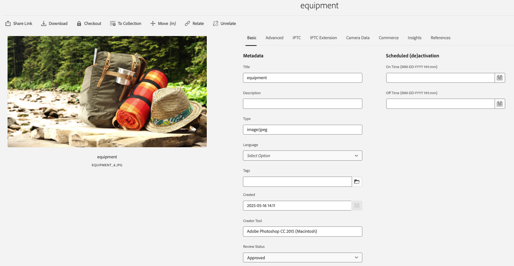

# Corrispondenza automatica predefinita

L&#39;integrazione AEM Assets per Commerce fornisce un meccanismo di corrispondenza automatica predefinito (**[!UICONTROL Match by product SKU]**) basato sulla configurazione dei metadati **AEM Assets**. Questa regola abilita la sincronizzazione perfetta tra **Adobe Commerce** e **AEM Assets**, garantendo che le risorse siano collegate automaticamente alle entità di merchandising corrette.

## Configurare il meccanismo di corrispondenza automatica

1. Dall&#39;amministratore di Commerce, passare a **[!UICONTROL Stores]** > **[!UICONTROL Settings]** > **[!UICONTROL Configuration]** > **[!UICONTROL ADOBE SERVICES]** > **[!UICONTROL AEM Assets Integration]**.

1. Specificare **[!UICONTROL Match by product SKU]** come regola corrispondente.

   {width="700" zoomable="yes"}

1. In **[!UICONTROL Match by product SKU attribute name]**, immetti il nome [della proprietà metadati](../metadata.md) che memorizza gli SKU dei prodotti in AEM Assets, non un valore SKU effettivo.

   >[!NOTE]
   >
   > Se è stato seguito il processo di onboarding standard, questo valore deve essere impostato su `commerce:skus`.

## Funzionamento del meccanismo di abbinamento automatico

Quando la regola di corrispondenza **[!UICONTROL Match by product SKU]** è configurata in Commerce Admin, i file di risorse Commerce vengono sincronizzati automaticamente da AEM Assets al progetto Commerce in base ai metadati delle risorse configurati per ciascun file. Puoi configurare i metadati dalla scheda AEM **Commerce** nell&#39;ambiente **AEM Assets author**:

1. Apri l’istanza di authoring di AEM Assets (l’URL viene fornito per il progetto nella stessa organizzazione IMS di Adobe Commerce).

1. Dalla schermata di navigazione principale, fai clic su **Assets** per accedere all&#39;interfaccia di Digital Asset Management (DAM).

1. In AEM Assets, aggiornare i metadati dell&#39;immagine per aggiungere l&#39;associazione Adobe Commerce impostando il campo `Eligible for Commerce` su `Yes`.

   {width="600" zoomable="yes"}

1. Configurare i metadati ([!UICONTROL SKU], [!UICONTROL position] e [!UICONTROL role]) che collegano la risorsa allo SKU del prodotto associato.

   I quattro ruoli standard sono `image`, `small_image`, `thumbnail` e `swatch_image`. Con l&#39;estensione AEM Assets Integration versione 1.4.6 e successive, è inoltre possibile immettere un ruolo immagine personalizzato, ad esempio `hero` o `custom_role_1`. Vedi [Corrispondenza automatica personalizzata](custom-match.md) per i dettagli.

   >[!NOTE]
   >
   > Se una risorsa viene utilizzata per più prodotti, configura i metadati per ogni SKU associata.

1. Nella scheda `Basic`, impostare il valore predefinito per il campo _[!UICONTROL Review Status]_&#x200B;su `approved`.

   {width="600" zoomable="yes"}

Dopo aver approvato la risorsa, [verifica l&#39;associazione del prodotto, il risultato della sincronizzazione e la visualizzazione della vetrina](../get-started/setup-synchronization.md#verify-the-integration). Se la risorsa non viene visualizzata, controlla [Stato sincronizzazione](../get-started/sync-status.md). Per Adobe Commerce Optimizer, utilizzare invece il flusso di lavoro di verifica dell&#39;optimizer [&#128279;](../get-started/configure-aco.md#match-by-sku-workflow-example). Stato sincronizzazione non disponibile.

[!BADGE Solo PaaS]{type=Informative tooltip="Applicabile solo ai progetti Adobe Commerce on Cloud (infrastruttura PaaS gestita da Adobe)."} Per ulteriori informazioni sulla risoluzione dei problemi di sincronizzazione, esaminare i [registri di integrazione](../get-started/logs.md).
