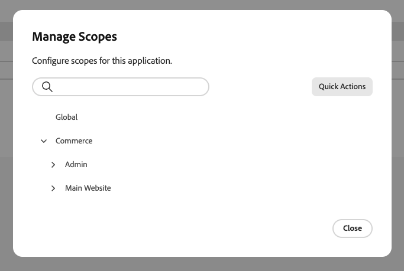

# Gestione dell’app

Utilizza [!DNL App Management] per associare, installare, configurare, aggiornare e annullare l&#39;associazione delle applicazioni App Builder all&#39;istanza Commerce. I moduli di configurazione vengono generati dallo schema di ogni app, per cui puoi gestire le impostazioni senza dover sviluppare un’interfaccia utente amministratore personalizzata.

{width="500" zoomable="yes"}

## Trovare un’applicazione in Admin

In **[!UICONTROL Apps]** > **[!UICONTROL App Management]**, ogni applicazione viene visualizzata come una scheda. L’elenco può includere ogni app associata all’istanza di Adobe Commerce per l’organizzazione Adobe IMS selezionata. Utilizza i controlli sopra le schede per limitare i risultati:

| Controllo | Descrizione |
| --- | --- |
| **[!UICONTROL Filter by app...]** | Cerca per nome applicazione. |
| **[!UICONTROL Status]** | Limita le schede in base allo stato del ciclo di vita. **[!UICONTROL All Statuses]** mostra ogni app; gli altri valori includono **[!UICONTROL Associated]**, **[!UICONTROL Installed]**, **[!UICONTROL Partially Installed]** e **[!UICONTROL Unassociated]**. Lo stato di ogni scheda corrisponde all’indicatore colorato nell’elenco. |
| **[!UICONTROL Extensibility patterns]** | Limita le schede in base alle funzionalità utilizzate dall’app. **[!UICONTROL All Extensibility Patterns]** mostra ogni app; gli altri valori sono allineati ai badge su ogni scheda, ad esempio **[!UICONTROL Business Configuration]**, **[!UICONTROL Admin UI SDK]**, **[!UICONTROL Webhooks]** e **[!UICONTROL Events]**. |

Il campo di ricerca ed entrambi i filtri si applicano insieme. Per visualizzare nuovamente l&#39;elenco completo, cancellare il campo di ricerca e selezionare **[!UICONTROL All Statuses]** e **[!UICONTROL All Extensibility Patterns]**.

### Rivedi dettagli applicazione

Sulla scheda dell&#39;applicazione, selezionare **[!UICONTROL Manage]** > **[!UICONTROL Details]** per esaminarne il nome, la descrizione e la versione. La finestra di dialogo fornisce due schede:

* **[!UICONTROL Details]** elenca i casi d&#39;uso aziendali dell&#39;applicazione, inclusi gli eventi e i passaggi di installazione personalizzati. Rivedi le etichette e le descrizioni per comprendere cosa aggiunge l’applicazione a Commerce.
* **[!UICONTROL App config]** visualizza la configurazione dell&#39;applicazione come JSON per l&#39;ispezione.

{width="600" zoomable="yes"}

{width="600" zoomable="yes"}

## Acquisire un’app

**[!UICONTROL Acquire App]** apre una nuova scheda del browser (o una visualizzazione del browser separata) in [Adobe Exchange](https://exchange.adobe.com/apps/browse/ec){target="_blank"}, dove puoi scoprire le inserzioni sul marketplace relative a Commerce e aggiungere applicazioni alla tua organizzazione Adobe IMS. Una volta acquisita, approvata e distribuita l&#39;app, questa verrà visualizzata in [!DNL App Management] per [associazione](#associate-an-app) e [installazione](#install-an-app).

## Prerequisiti

Prima di associare un’app, assicurati di disporre dei seguenti elementi:

| Requisito | Descrizione |
| --- | --- |
| **Accesso amministratore** | Amministratore Commerce con autorizzazioni [!DNL App Management] |
| **App implementata** | Applicazione App Builder distribuita nella tua organizzazione e pronta per la connessione |
| **Accesso organizzazione** | Accesso all’organizzazione Adobe in cui è distribuita l’app |

## Esercitazione

Guarda questo video per scoprire come associare un’app a un’istanza Commerce e configurare le impostazioni.

>[!VIDEO](https://video.tv.adobe.com/v/3478944)

## Associare un’app

Il processo di associazione importa siti web, store e visualizzazioni dello store da Commerce e crea il collegamento tra l’app e l’istanza Commerce.

Per collegare l’applicazione App Builder a un’istanza Commerce:

1. Passa a **[!UICONTROL Apps]** > **[!UICONTROL App Management]**.

1. Fare clic su **[!UICONTROL Associate App]**.

   {width="500" zoomable="yes"}

1. Selezionare **[!UICONTROL Project]** dall&#39;elenco.

1. Selezionare **[!UICONTROL Workspace]**.

1. Fare clic su **[!UICONTROL Associate]**.

   {width="500" zoomable="yes"}

>[!WARNING]
>
>Se la sincronizzazione dell&#39;ambito non riesce, l&#39;associazione viene comunque completata. È possibile sincronizzare manualmente gli ambiti in un secondo momento dalla vista **[!UICONTROL Manage Scopes]** nella configurazione dell&#39;app associata.

## Installare un’app

L’associazione collega un’app all’istanza di Commerce. Per le app che includono componenti installabili, come eventi, webhook, estensioni dell’interfaccia utente amministratore o passaggi di installazione personalizzati, l’installazione applica tali componenti all’istanza.

1. Aprire la finestra di dialogo di installazione dell&#39;app associata in [!DNL App Management].

1. Esaminare i casi di utilizzo aziendali dell&#39;applicazione e i passaggi di installazione elencati.

1. Se vengono visualizzati **[!UICONTROL Pre Installation Instructions]**, completare i prerequisiti prima di procedere.

   {width="600" zoomable="yes"}

1. Fare clic su **[!UICONTROL Install]**.

1. Monitorare gli indicatori di avanzamento per i singoli elementi fino al termine dell&#39;installazione.

   {width="600" zoomable="yes"}

   >[!WARNING]
   >
   >Tenere aperta la pagina fino al termine dell&#39;installazione. La chiusura o l&#39;aggiornamento della pagina potrebbe impedire il corretto completamento dell&#39;installazione.

1. Verificare che **[!UICONTROL Successfully Installed]** sia visualizzato e che gli elementi completati abbiano segni di spunta.

   {width="600" zoomable="yes"}

1. Completa le istruzioni di post-installazione fornite dall&#39;app, quindi [configurane le impostazioni](#configure-settings) in base alle esigenze.

## Configurare le impostazioni

Dopo aver associato un&#39;app nella visualizzazione [!DNL App Management], configurarne le impostazioni tramite il modulo:

1. Sulla scheda dell&#39;app associata, seleziona **[!UICONTROL Manage]** > **[!UICONTROL Configure]**.

Nel modulo vengono visualizzate le impostazioni configurabili dell’app.

1. Modificare i valori in base alle esigenze.

1. Fare clic su **[!UICONTROL Save]**.

### Configurazione specifica per ambito

Utilizza la configurazione specifica dell’ambito quando siti web, store o viste store diverse richiedono impostazioni univoche. Ad esempio, è possibile abilitare una funzione solo per una specifica area geografica o vista store oppure utilizzare impostazioni diverse per marchio. Le impostazioni in un ambito inferiore sovrascrivono quelle degli ambiti superiori.

Per ignorare i valori globali a un livello di ambito specifico:

1. Fare clic su **[!UICONTROL Change Scope]**.

1. Selezionare un ambito dall&#39;elenco.

1. Modificare i valori per questo ambito.

1. Fare clic su **[!UICONTROL Save]**.

## Gestisci ambiti

Accedi a **[!UICONTROL Manage Scopes]** dalla schermata dei dettagli dell&#39;app per gestire la gerarchia dell&#39;ambito per la tua app.

{width="500" zoomable="yes"}

| Azione | Descrizione |
| --- | --- |
| **[!UICONTROL Add root scope]** | Aggiungi un ambito che si applica solo all&#39;app. |
| **[!UICONTROL Sync Commerce scopes]** | Aggiornare l&#39;elenco dei siti Web, dei negozi e delle visualizzazioni dello store da Commerce dopo averli aggiunti o modificati. |
| **[!UICONTROL Import scopes]** | Importa gli ambiti in blocco da un file. |

## Aggiornare un’app

Quando lo sviluppatore dell&#39;app distribuisce una nuova versione di un&#39;app installata, [!DNL App Management] riceve una notifica della disponibilità di un aggiornamento. L’implementazione di App Builder e un aggiornamento di App Management sono operazioni separate: l’aggiornamento applica le modifiche pianificate ai componenti installati, come eventi, webhook ed estensioni dell’interfaccia utente di amministrazione.

Chiedi al tuo sviluppatore di app di confermare che l’app supporta gli aggiornamenti. Per i prerequisiti di SDK e i requisiti di migrazione, consulta [Aggiornare l&#39;app](https://developer.adobe.com/commerce/extensibility/app-management/upgrade-app/){target="_blank"} nella documentazione per gli sviluppatori.

### Rivedere e avviare un aggiornamento

In modalità manuale, che è l&#39;impostazione predefinita, è possibile rivedere e avviare l&#39;aggiornamento in [!DNL App Management].

1. Registra la versione e la configurazione dell’app installata ed esegui il backup dei dati dell’applicazione e delle risorse esterne con l’aiuto dello sviluppatore dell’app.

1. Passa a **[!UICONTROL Apps]** > **[!UICONTROL App Management]** e apri l&#39;aggiornamento disponibile per l&#39;app.

1. Esamina le modifiche pianificate ed eventuali avvisi. Un aggiornamento può aggiungere, modificare o rimuovere componenti. Se un passaggio di installazione personalizzato viene rimosso, lo script di disinstallazione non viene eseguito e le risorse create non vengono pulite automaticamente. Prima di procedere, conferma le operazioni di pulizia necessarie con lo sviluppatore dell’app.

1. Avvia l’aggiornamento e monitora l’avanzamento delle operazioni elencate.

1. Esaminare il risultato dell&#39;aggiornamento e verificare la presenza di operazioni non riuscite. Se l&#39;aggiornamento non riesce, seguire [L&#39;aggiornamento non riesce](troubleshooting.md#upgrade-fails) prima di utilizzare **[!UICONTROL Retry Upgrade]**.

In modalità manuale, le modifiche pianificate ai componenti Commerce installati non vengono applicate fino all’avvio dell’aggiornamento. Tuttavia, la distribuzione può aggiornare il codice dell’azione di runtime già utilizzato dall’app installata prima dell’esecuzione dell’aggiornamento.

### Aggiornamenti automatici

Lo sviluppatore dell’app controlla la modalità di aggiornamento. Chiedi allo sviluppatore di confermare se l’app utilizza aggiornamenti manuali o automatici.

>[!WARNING]
>
>Gli aggiornamenti automatici sono sperimentali e vengono avviati dopo la distribuzione senza la revisione dell’amministratore, inclusi gli script di installazione personalizzati che possono modificare le risorse esterne. Coordina con lo sviluppatore prima di abilitare gli aggiornamenti automatici, anche quando una nuova versione distribuita cambia la modalità da manuale a automatica.

### Modifiche alla configurazione aziendale

Le modifiche allo schema di configurazione aziendale dell’app vengono visualizzate automaticamente dopo la distribuzione. Sono separati dall’installazione e dagli aggiornamenti e non attivano un aggiornamento dell’app.

## Annullare l’associazione di un’app

Annulla l’associazione di un’app quando non è più necessaria e connessa all’istanza di Commerce. Ad esempio, potrebbe essere necessario ritirare un’integrazione, passare a un’area di lavoro diversa o pulire le configurazioni di test.

>[!WARNING]
>
>L’annullamento dell’associazione rimuove tutti i valori di configurazione per questa istanza. Questa operazione non può essere annullata. La disinstallazione può anche rimuovere componenti e risorse dell’app tramite script di disinstallazione personalizzati.

Prima di procedere, registra la versione e la configurazione installate, esegui il backup dei dati dell’applicazione e chiedi allo sviluppatore dell’app quali risorse vengono rimosse dagli script di disinstallazione dell’app e quali richiedono la pulizia manuale. Pianifica eventuali interruzioni del servizio e come ripristinare l’app, le sue impostazioni e i relativi dati. Per gli aggiornamenti di routine, [aggiorna l&#39;app](#upgrade-an-app) invece di annullare l&#39;associazione.

Per rimuovere un’app da un’istanza di Commerce:

1. Passa a **[!UICONTROL Apps]** > **[!UICONTROL App Management]**.

1. Sulla scheda dell&#39;app, seleziona **[!UICONTROL Manage]** > **[!UICONTROL Unassociate]**.

1. Esamina i casi d’uso aziendali e i componenti elencati interessati dalla disinstallazione, inclusi gli eventi e i passaggi di installazione personalizzati.

   {width="600" zoomable="yes"}

1. Conferma l’azione.

## Documentazione correlata

* [Risoluzione dei problemi [!DNL App Management]](troubleshooting.md) - Risolvi i problemi più comuni relativi all&#39;associazione, all&#39;installazione, alla configurazione e agli aggiornamenti.
* [Aggiorna l&#39;app](https://developer.adobe.com/commerce/extensibility/app-management/upgrade-app/){target="_blank"} - Requisiti degli sviluppatori per le modalità di aggiornamento, gli script di migrazione e la diagnostica.
