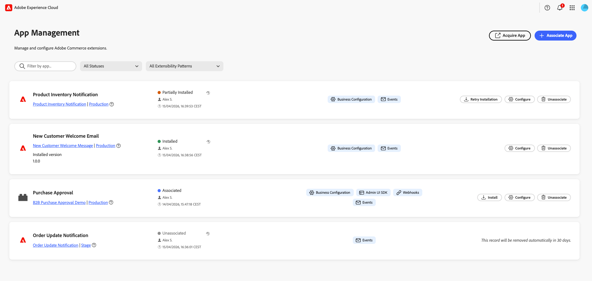

# Panoramica di [!DNL App Management]

[!DNL App Management] in Adobe Commerce semplifica il modo in cui le applicazioni vengono individuate, installate, configurate e gestite nell&#39;ambiente commerce. Fornisce un framework unificato che consente alle organizzazioni di adottare l&#39;estensibilità in modo sicuro ed efficiente riducendo al contempo gli attriti operativi.

{width="500" zoomable="yes"}

Per **App Manager**, [!DNL App Management] offre una visualizzazione centralizzata di tutte le applicazioni installate, semplificando la governance, la gestione del ciclo di vita e la supervisione operativa. Grazie a flussi di installazione semplificati, passaggi di configurazione automatizzati e una chiara visibilità dello stato e delle autorizzazioni delle app, gli operatori tecnici e aziendali possono gestire le integrazioni in modo affidabile, senza richiedere un profondo coinvolgimento tecnico.

Per **sviluppatori di app**, [!DNL App Management] introduce un metodo standardizzato per creare pacchetti e distribuire applicazioni utilizzando un manifesto dichiarativo dell&#39;app. Gli sviluppatori possono definire la configurazione, le sottoscrizioni di eventi, le autorizzazioni e i passaggi successivi all’installazione in un’unica posizione, consentendo alle applicazioni di installare e configurare automaticamente all’interno di un ambiente di esercenti. In questo modo è possibile ridurre l&#39;impegno di integrazione, migliorare l&#39;affidabilità dell&#39;installazione e consentire agli sviluppatori di concentrarsi sul valore aziendale anziché sulla gestione della complessità dell&#39;installazione.

Queste funzionalità creano insieme un modello di estensibilità scalabile che consente ai commercianti di adottare nuove funzionalità più rapidamente, fornendo al contempo agli sviluppatori un ciclo di vita delle applicazioni prevedibile e semplificato.

## Cosa offre [!DNL App Management]

* **Un posto per tutte le tue app**. Associa, configura e gestisci le app da **[!UICONTROL Apps]** > **[!UICONTROL App Management]**. [Cerca, filtra e acquisisci app](manage-app.md) dalla stessa visualizzazione.
* **Impostazioni corrispondenti alla tua azienda**. Applica diverse configurazioni per la visualizzazione di siti web, store o store per configurazioni con più aree geografiche o marchi.
* **Sincronizzazione automatica archivio**. I siti Web, gli store e le visualizzazioni dello store di Commerce vengono importati quando si associa un&#39;app.
* **Esperienza di amministrazione nativa**. Utilizza le app di Adobe Exchange o le distribuzioni personalizzate senza uscire da Commerce.

## Chi utilizza [!DNL App Management]?

| Ruolo | Caso d’uso |
|------|----------|
| **App manager** | Associa le app, configura le impostazioni e gestisci le app nell’istanza Commerce. |
| **Amministratori Commerce** | Supervisiona le configurazioni e le autorizzazioni dell’app in tutta l’organizzazione. |
| **Architetti tecnici** | Assicurati che le app siano configurate correttamente per distribuzioni in più store o aree geografiche. |

## Cosa puoi fare

* **Associa un&#39;app**. Collega un’applicazione App Builder all’istanza Commerce selezionando il progetto e l’area di lavoro.
* **Configura impostazioni**. Regola le impostazioni dell’app tramite il modulo generato automaticamente; se necessario, sostituisci i valori per store o area geografica.
* **Gestisci ambiti**. Mantieni la gerarchia dello store sincronizzata con le tue app e applica le impostazioni al livello giusto.
* **Annulla associazione di un&#39;app**. Rimuovere un’app quando si ritira un’integrazione o si puliscono le configurazioni di test.

## Passaggi successivi

* [Installa](install.md). Verificare che i prerequisiti siano soddisfatti e accedere a [!DNL App Management].
* [Gestisci la tua app](manage-app.md). Associa, configura e annulla l&#39;associazione di app.

## Per sviluppatori

Se stai creando applicazioni App Builder per Adobe Commerce, consulta la documentazione [Commerce Extensibility [!DNL App Management]](https://developer.adobe.com/commerce/extensibility/app-management/){target="_blank"} per lo schema di configurazione, le azioni di runtime e la configurazione degli sviluppatori.
