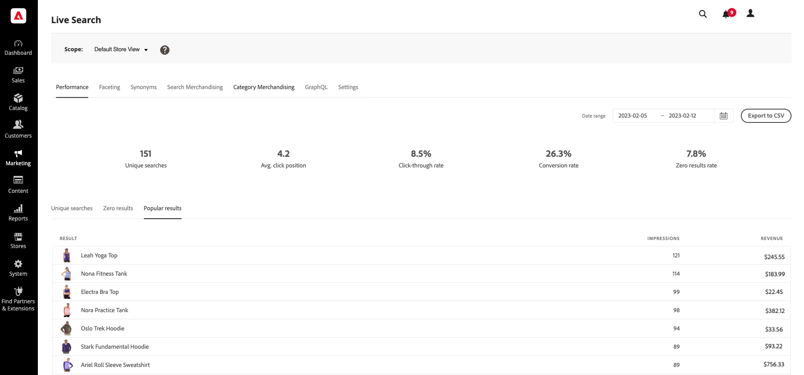

# Migliorare l’individuazione dei prodotti con Adobe Commerce Live Search

<table style="table-layout:auto">
<tr style="border: 0;">
   <td valign="middle" style="vertical-align: middle;"> <strong>Sandra Gonzalez Mangana</strong> <em>Senior Product Manager</em></td>
</tr>
</table>

*Aiutare gli acquirenti a trovare i prodotti di cui hanno bisogno con le informazioni sulle prestazioni di ricerca e la ricerca semantica.*

Disporre dei prodotti giusti nel catalogo è solo una parte dell’esperienza di acquisto. Gli acquirenti devono anche essere in grado di trovare tali prodotti utilizzando le parole, le frasi e le domande che usano naturalmente.

Adobe Commerce Live Search fornisce informazioni approfondite sulle prestazioni delle ricerche che possono aiutarti a individuare i problemi e a perfezionare l’esperienza. Utilizza queste informazioni per indagare dove gli acquirenti hanno difficoltà e non solo se la ricerca restituisce i risultati.

## Ricerca di segnali nelle prestazioni di ricerca

Nell’area di lavoro Prestazioni di Live Search, controlla metriche quali ricerche univoche, ricerche con risultato zero, risultati popolari, tasso di click-through, tasso di conversione e posizione media di clic. Utilizzali per identificare le tendenze e decidere quali query o prodotti richiedono attenzione. [Prestazioni](https://experienceleague.adobe.com/it/docs/commerce/live-search/live-search-admin/performance)

{width="800" zoomable="yes"}

*L&#39;area di lavoro Prestazioni Live Search mostra le metriche da rivedere. I valori visualizzati sono dati di esempio.*

Considera questi segnali:

- **Ricerche senza risultati:** Le query senza risultati possono indicare spazi vuoti nel catalogo, nelle informazioni sul prodotto o nella configurazione della ricerca. Mantieni le ricerche con risultato zero al di sotto del 5%. Un tasso superiore a questa soglia è un segnale che vale la pena esaminare.
- **Posizione di click-through bassa o di clic debole:** Gli acquirenti potrebbero vedere risultati che non corrispondono alle loro esigenze, oppure i prodotti pertinenti potrebbero non essere abbastanza prominenti. Per garantire il coinvolgimento, cerca di ottenere un clic sul prodotto per almeno il 50% delle ricerche.
- **Bassa conversione dalla ricerca:** verifica se la ricerca aiuta gli acquirenti a passare da una query a un acquisto. Mirare a un tasso di conversione superiore al 3%.

Considerali come benchmark e segnali diagnostici, non come pass-or-fail universale. Le prestazioni variano in base al settore, alla complessità del catalogo, al comportamento del cliente e al modo in cui viene misurata ogni metrica. Stabilisci una linea di base per lo store e confronta le prestazioni nel tempo. I risultati possono variare in base al catalogo, agli acquirenti e al modo in cui si misurano i risultati.

## Corrispondenza con l&#39;intento dell&#39;acquirente, non solo con parole esatte

Gli acquirenti non sempre descrivono i prodotti utilizzando la terminologia presente nel catalogo. Qualcuno alla ricerca di &quot;scarpe comode da stare in piedi tutto il giorno&quot;, per esempio, potrebbe essere interessato ai prodotti descritti come &quot;sneakers da passeggio ammortizzate&quot;.

La ricerca semantica utilizza significato e contesto insieme alla corrispondenza delle parole chiave, aiutando a collegare le query in linguaggio naturale ai prodotti rilevanti anche quando la query non corrisponde esattamente al testo del catalogo. Live Search combina la corrispondenza di parole chiave e semantiche in un’unica esperienza di ricerca. [Ricerca semantica](https://experienceleague.adobe.com/it/docs/commerce/live-search/live-search-admin/semantic-search)

La corrispondenza semantica può essere utile per le ricerche esplorative, ma la rilevanza dipende ancora dai prodotti e dalle informazioni disponibili nel catalogo. Per le ricerche che richiedono un modello, una specifica o un requisito di compatibilità esatti, verifica che i risultati rimangano precisi.

## Controllare la ricerca semantica per la distribuzione

La configurazione dipende dal prodotto Adobe Commerce utilizzato:

- **Adobe Commerce sull&#39;infrastruttura cloud o on-premise:** la ricerca semantica Live Search è disponibile per Adobe Commerce 2.4.4 e versioni successive. In Amministratore, vai a Marketing > SEO &amp; Search > Live Search (Marketing > SEO e ricerca), apri Impostazioni, abilita ricerca semantica e salva. Supporta i cataloghi in inglese. [Impostazioni—Ricerca semantica](https://experienceleague.adobe.com/it/docs/commerce/live-search/live-search-admin/settings)
- **Adobe Commerce as a Cloud Service:** Per impostazione predefinita, il sistema abilita la ricerca semantica. Supporta i cataloghi in inglese. [Ricerca semantica](https://experienceleague.adobe.com/it/docs/commerce/live-search/live-search-admin/semantic-search)
- **Adobe Commerce Optimizer:** Il sistema abilita la ricerca semantica per impostazione predefinita. Facoltativamente, puoi regolare controlli quali l’incremento semantico e la soglia di somiglianza. Le impostazioni includono anche opzioni di ricerca fuzzy. [Ricerca semantica](https://experienceleague.adobe.com/it/docs/commerce/optimizer/setup/semantic-search) · [Impostazioni—Ottimizzazione facoltativa](https://experienceleague.adobe.com/it/docs/commerce/optimizer/settings)

## Trasforma gli insight della ricerca in azione

Utilizza un ciclo di revisione continuo per migliorare l’individuazione dei prodotti:

1. **Ricerca delle query da analizzare.** Esamina le ricerche con zero risultati, le query più comuni e le ricerche con coinvolgimento ridotto.
2. **Controlla cosa sta chiedendo l&#39;acquirente.** Determina se la query punta a un prodotto mancante, a una mancata corrispondenza delle parole o a dati di prodotto non chiari.
3. **Migliorare le informazioni sul prodotto.** Rendi gli attributi e le descrizioni del prodotto precisi e utili per i termini utilizzati dagli acquirenti. Per Live Search, Adobe consiglia di impostare gli attributi e i pesi ricercabili appropriati e di assicurarsi che i dati degli attributi siano rilevanti. [Best practice per Live Search](https://experienceleague.adobe.com/it/docs/commerce/live-search/best-practice)
4. **Perfeziona l&#39;esperienza di ricerca.** Se necessario, utilizza regole di ricerca, sinonimi e facet per aiutare gli acquirenti a trovare e limitare i risultati rilevanti. [Best practice per Live Search](https://experienceleague.adobe.com/it/docs/commerce/live-search/best-practice)
5. **Rivedi i risultati e ripeti.** Monitora le stesse query e gli stessi segnali di prestazioni dopo aver apportato modifiche, quindi regola in base a ciò che fanno gli acquirenti.

## Conteggio di ogni ricerca

Una query di ricerca è un segnale di ciò che un acquirente vuole. Combinando le informazioni sulle prestazioni di ricerca con le informazioni rilevanti sui prodotti e le funzionalità di ricerca corrette, puoi facilitare l’individuazione dei prodotti che soddisfano le esigenze degli acquirenti.

### Ulteriori informazioni

- [Cos’è Live Search?](../../../live-search/overview.md)
- [Best practice per Live Search](../../../live-search/best-practice.md)
- [Ricerca semantica](../../../live-search/semantic-search.md) per Adobe Commerce sull&#39;infrastruttura cloud
- [Ricerca semantica](../../../optimizer/setup/semantic-search.md) per Adobe Commerce Optimizer
