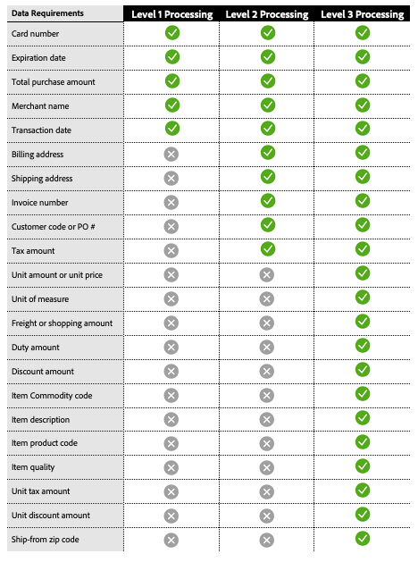

# Elaborazione di livello 2 e livello 3

[!DNL Payment Services] offre funzionalità avanzate di elaborazione delle carte per aiutare gli esercenti a ottimizzare le transazioni di pagamento e ridurre le commissioni interbancarie. Sono disponibili tre livelli di elaborazione delle carte, ciascuno con requisiti di trattamento diversi per le operazioni.

>[!CAUTION]
>
> [Gli ordini Fastlane](payments-options.md#fastlane-button) non includono dati di livello 2/livello 3, elementi riga e raggruppamento importo.

## Requisiti dei dati per livello di elaborazione

{width="500" zoomable="yes"}

[!DNL Payment Services] raccoglie questi dati e fornisce rapporti dettagliati sulle transazioni di pagamento.

## Livelli di elaborazione disponibili per rete di schede

{width="500" zoomable="yes"}

Per ulteriori informazioni, consulta [elaborazione dei pagamenti](https://developer.paypal.com/docs/checkout/advanced/processing/){target=_blank} nella documentazione per gli sviluppatori di PayPal.

### Livello 1

Il livello 1 è il più comune, richiede meno informazioni e pertanto è soggetto generalmente a commissioni di interscambio più elevate rispetto alle operazioni trattate con dati di livello 2 o 3, che sono solitamente collegate alle carte di credito aziendali e di acquisto.

### Livello 2 e livello 3

Gli esercenti [!DNL Payment Services] di Interchange Plus (IC++) possono qualificarsi per l&#39;elaborazione di livello 2/livello 3 se forniscono ulteriori dettagli sulle transazioni alle reti di carte e soddisfano specifici criteri di qualifica. Questi livelli sono particolarmente vantaggiosi per gli esercenti che gestiscono volumi significativi di acquisti o di carte aziendali, in quanto possono comportare risparmi significativi sui costi. La fornitura di dati dettagliati di livello 2 o 3 può:

* Riduzione delle tariffe di elaborazione e ottimizzazione dei costi complessivi
* Prevenzione delle frodi, riduzione dei rischi per il processore
* Migliorare la sicurezza delle transazioni

Vedere [Che cos&#39;è IC++?](https://www.paypal.com/us/brc/article/what-is-interchange-plus-plus){target=_blank} nella documentazione per gli sviluppatori di PayPal per ulteriori informazioni.

## Transazioni di pagamento con carta di livello 2 e 3 in [!DNL Payment Services]

Per essere classificate nei livelli 2 o 3, le informazioni precedentemente trasmesse devono essere inviate dagli esercenti, sebbene siano le reti di carte a determinare, in ultima analisi, il livello al quale un&#39;operazione si qualifica per l&#39;elaborazione.

Per ulteriori informazioni, consulta le [Domande frequenti sull&#39;elaborazione dei pagamenti](https://www.paypal.com/us/cshelp/article/ts2278?_ga=1.131773126.875104296.1712843492){target=_blank} nella documentazione per gli sviluppatori di PayPal.

L&#39;elaborazione dei livelli 2 e 3 è disabilitata per impostazione predefinita per [!DNL Payment Services] commercianti a livello di store.

L&#39;elaborazione di livello 2 e livello 3 è disponibile se si utilizza già la determinazione prezzi IC++. Per abilitare questa funzionalità è possibile eseguire questa operazione tramite l&#39;interfaccia della riga di comando [CLI](configure-cli.md).

>[!IMPORTANT]
>
>In caso di domande, contattare l&#39;account manager [!DNL Payment Services].
